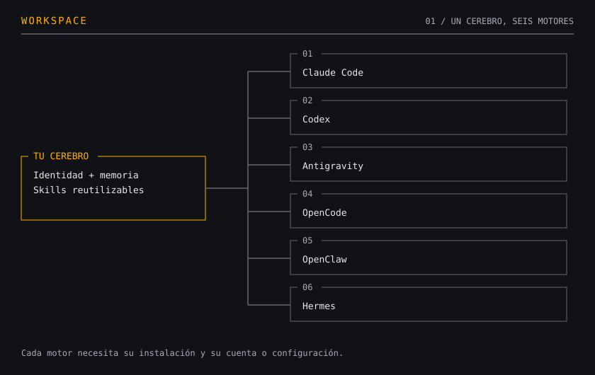
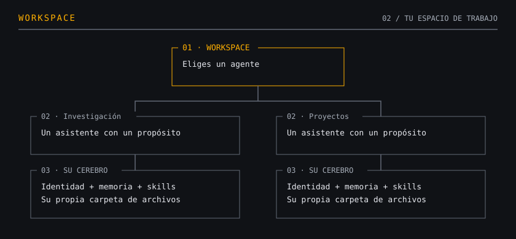
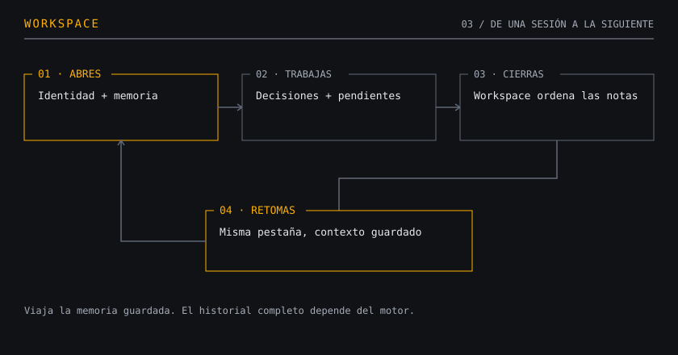
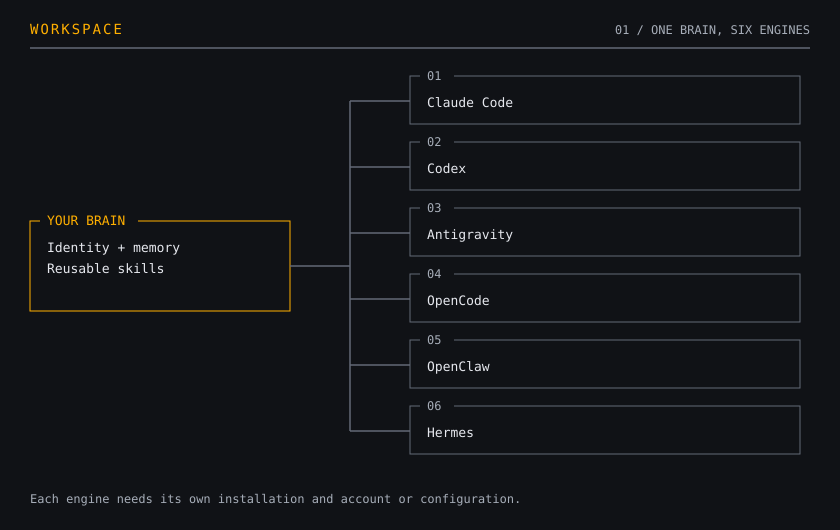
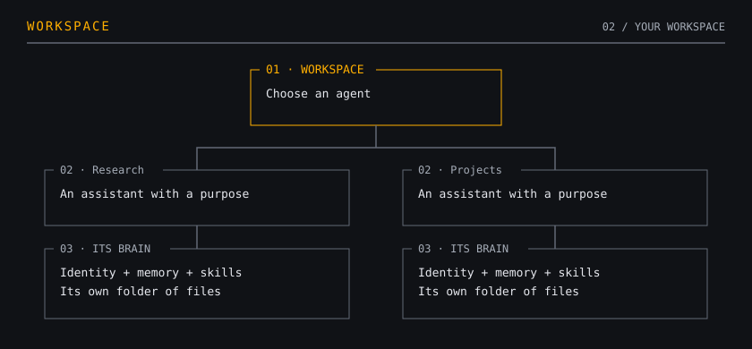
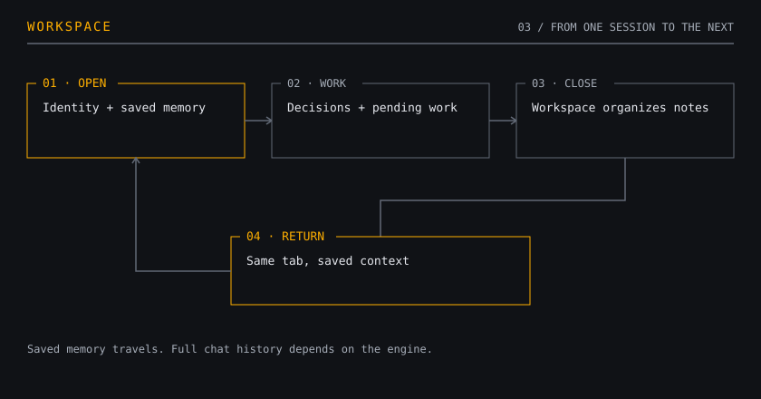

<!-- markdownlint-disable MD033 MD041 -->
<div align="center">

# Workspace

Choose your AI engine. Keep your agents and their memory.

Elige tu motor de IA. Conserva tus agentes y su memoria.

[Español](#español) · [English](#english) · [Manual](manual/README.md) · [MIT](LICENSE)

macOS · Windows · Linux | Python 3.9+ | En desarrollo activo

</div>

<a id="español"></a>

## Español

### Elige tu motor. Conserva tu agente.

Workspace te permite trabajar con Claude Code, Codex, Antigravity, OpenCode, OpenClaw o Hermes desde un mismo menú. Puedes cambiar de motor conservando la identidad, las skills y la memoria guardada de tu agente.



Conservas el cerebro y eliges qué programa lo usa. Cada motor necesita su propia instalación y tu cuenta o configuración. No todos ofrecen las mismas funciones: consulta la [compatibilidad por motor y sistema](manual/es/compatibilidad.md).

Workspace organiza el trabajo. Las respuestas las produce el modelo que usa tu motor, y sus límites, herramientas y costos siguen dependiendo de ese proveedor.

### ¿Para qué sirve?

Imagina que tienes un asistente para investigar y otro para trabajar en tus proyectos. Quieres que cada uno conserve sus instrucciones, lo que aprende y los pendientes de cada conversación. También quieres poder cambiar de herramienta de IA sin empezar a definirlos desde cero.

Workspace reúne esas piezas en un menú de terminal. Desde ahí creas tus agentes, abres sus conversaciones y eliges con qué motor trabajan. La terminal es la ventana de texto donde escribes comandos y hablas con ellos.



Los agentes del mapa son ejemplos. Tú decides cuántos crear y para qué usarlos.

### Cuatro ideas para entenderlo

| Pieza | Qué significa | Ejemplo |
|---|---|---|
| Agente | Tu asistente con nombre, propósito e instrucciones | Un asistente que te ayuda a investigar |
| Cerebro | La carpeta donde guarda su identidad, conocimientos y procedimientos | Archivos legibles que conservas en tu computadora |
| Motor | El programa de IA que ejecuta al agente y le da sus herramientas | Claude Code o Codex |
| Pestaña | Un espacio de conversación con sus propios pendientes y memoria | Una investigación concreta que retomas mañana |

Una skill es un procedimiento reutilizable: por ejemplo, cómo preparar un informe siguiendo tus criterios. Vive en el cerebro, junto con la memoria.

### ¿Qué pasa cuando trabajas?



Por ejemplo: investigas un tema, eliges una opción y dejas dos pendientes. Cuando vuelves a esa pestaña, el agente recibe lo que quedó registrado para continuar. Puedes abrirla con otro motor.

Esto comparte la memoria guardada. El historial completo del chat y las herramientas disponibles dependen de cada motor. No significa que recuerde cada palabra ni garantiza recuperar una sesión tras un cierre forzado.

### Lo que puedes hacer desde el menú

| Sección | Para qué la abres |
|---|---|
| Agentes | Crear o cargar un agente, elegir su motor y ajustar sus opciones |
| Motores | Comprobar cuáles tienes instalados y con sesión iniciada |
| Usuarios | Indicar quién usa un agente en esta computadora |
| Temas | Cambiar la apariencia del menú |
| Actualizaciones | Actualizar, elegir cómo recibir novedades o volver a la versión anterior |
| Documentación | Entender cada función y ver el mapa de memoria con tus archivos reales |

Dentro de las secciones, la tecla `i` explica su funcionamiento. Para empezar, basta con crear un agente y abrir una pestaña.

### Tus archivos, permisos y costos

El cerebro vive en una carpeta separada de Workspace. Puedes abrir sus archivos, respaldarlos y llevártelos. Reinstalar el programa no exige reconstruir a tus agentes. Llevar un cerebro a otra computadora requiere copiarlo o sincronizarlo y configurar allí el motor.

Los permisos dependen del motor y de las opciones del agente. Workspace conserva las protecciones del motor: no asumas que todos ofrecen el mismo aislamiento. La [guía de motores](manual/es/motores.md#permisos) explica las diferencias.

Tus solicitudes y los archivos que el agente use pueden enviarse al proveedor de IA elegido. Que el cerebro sea local no convierte en local al modelo. Revisa la [guía de privacidad](manual/es/privacidad.md) antes de trabajar con información sensible.

Workspace se distribuye con licencia MIT. El acceso a los motores y modelos puede requerir suscripciones o consumo de API, que pagas a sus proveedores. La revisión opcional de skills también usa tu motor y puede consumir cuota.

### Instalar y empezar

Necesitas Python 3.9 o superior, Git y al menos un motor instalado con tu cuenta configurada. No necesitas instalar paquetes de Python con pip para el núcleo de Workspace.

<details>
<summary>macOS o Linux</summary>

```bash
curl -fsSL https://raw.githubusercontent.com/MaxGarcia399/workspace/main/setup.sh | bash
```

</details>

<details>
<summary>Windows, desde PowerShell</summary>

```powershell
irm https://raw.githubusercontent.com/MaxGarcia399/workspace/main/setup.ps1 -OutFile $env:TEMP\workspace-setup.ps1
powershell -NoProfile -ExecutionPolicy Bypass -File $env:TEMP\workspace-setup.ps1
```

Instala fuera de OneDrive. La ubicación por defecto es `%LOCALAPPDATA%\Workspace`. Abre una terminal nueva al terminar.

</details>

Después, escribe `workspace`, crea o carga un agente y abre una pestaña. Si algo falla, `workspace doctor` revisa la instalación. La [guía de instalación](manual/es/instalar.md) incluye el procedimiento manual y el [primer arranque](manual/es/primer-arranque.md) explica los siguientes pasos.

Las actualizaciones son automáticas por defecto. Puedes cambiarlas a solo avisar o apagarlas desde Actualizaciones. `workspace update` actualiza cuando tú quieras y `workspace update --rollback` vuelve a la anterior. Los ajustes que una actualización deba hacer en el cerebro llevan respaldo. [Cómo funcionan las actualizaciones](manual/es/actualizaciones.md).

### Novedades de la v0.5.1

- El mapa de memoria está en Documentación y deja de ocupar la portada del menú.
- Las skills que aprende Hermes se guardan en el cerebro para que otros motores también las encuentren.
- Se corrigieron problemas de memoria entre pestañas y de integración con Hermes y OpenClaw.
- Se corrigió el movimiento inicial del cursor cuando todavía no hay agentes.

### Historial resumido

Lo que fuimos añadiendo y corrigiendo, de lo más reciente al inicio del proyecto. Estos son cambios de cada versión, no instrucciones de uso actuales.

| Versión | Lo que se añadió o cambió | Lo que se corrigió |
|---|---|---|
| 0.5.0 | Pantalla «Cargando…», mapa de memoria y mejor integración con Hermes y OpenClaw | Textos oscuros en los chats y avisos sobre instrucciones antiguas |
| 0.4.1 | Mantenimiento de Usuarios | Dejaron de aparecer usuarios de ejemplo como personas reales |
| 0.4.0 | Memoria por pestaña entre motores, Usuarios y Documentación; revisión de skills en la sesión visible | Identificación de usuarios entre máquinas y apertura simultánea de agentes con OpenClaw |
| 0.3.3 | Ajuste del primer arranque | Se eliminó el aviso de configuración incompleta que podía quedarse tras terminar |
| 0.3.2 | Corrección inicial del aviso del primer arranque | Entrar solo a mirar ya no debía dejar la configuración como pendiente |
| 0.3.1 | Secciones más sencillas, ayudas con mapas y verificación de sesión de motores | Motores dejó de perder el teclado durante la verificación |
| 0.3.0 | Permisos por agente, revisión opcional de skills y diagnóstico centrado en lo esencial | Se retiraron permisos generales para ejecutar comandos sin preguntar |
| 0.2.0 | Lanzador con búsqueda, opciones de actualización y regreso a la versión anterior | La actualización comprueba el arranque y vuelve atrás si la nueva versión falla |
| 0.1.0 | Primera versión: menú de terminal, cerebros propios, motores intercambiables, instalación guiada y doctor | Punto de partida |

Historial completo, con todos los detalles: [CHANGELOG](CHANGELOG.md).


### Para seguir explorando

[Manual en español](manual/es/README.md) · [Compatibilidad](manual/es/compatibilidad.md) · [Privacidad](manual/es/privacidad.md) · [Principios del proyecto](manual/MANIFESTO.md)

Workspace está en desarrollo activo. Las funciones y su integración varían por motor y sistema. Para reportar una vulnerabilidad, sigue [SECURITY.md](SECURITY.md) y evita publicar datos sensibles en una incidencia.

---

<a id="english"></a>

## English

### Choose your engine. Keep your agent.

Workspace lets you work with Claude Code, Codex, Antigravity, OpenCode, OpenClaw or Hermes from one menu. Switch engines while keeping your agent’s identity, skills and saved memory.



Keep the brain and choose which program uses it. Each engine needs its own installation and your account or configuration. Features vary: see [compatibility by engine and operating system](manual/en/compatibility.md).

Workspace organizes the work. Your engine's model generates the responses. Its provider still determines the limits, tools and costs.

### What is it for?

Imagine having one assistant for research and another for your projects. Each needs its own instructions, knowledge and pending work. You also want to change AI tools without defining those assistants all over again.

Workspace brings those pieces together in a terminal menu. Create your agents, open their conversations and choose which engine runs them. The terminal is the text window where you enter commands and talk to your agents.



These agents are examples. You choose how many to create and what they do.

### Four ideas to understand it

| Piece | Meaning | Example |
|---|---|---|
| Agent | Your assistant with a name, purpose and instructions | A research assistant |
| Brain | The folder holding its identity, knowledge and procedures | Readable files you keep on your computer |
| Engine | The AI program that runs the agent and provides its tools | Claude Code or Codex |
| Tab | A conversation space with its own memory and pending work | Research you return to tomorrow |

A skill is a reusable procedure, such as how to prepare a report using your criteria. It lives in the brain alongside the memory.

### What happens while you work?



For example, you research a topic, choose an option and leave two things to do. When you return to that tab, the agent receives the recorded information to continue. You can open it with another engine.

This shares saved memory. The full chat history and available tools depend on each engine. It does not mean remembering every word or guarantee recovery after a forced shutdown.

### What you can do from the menu

| Section | Why you open it |
|---|---|
| Agents | Create or load an agent, choose its engine and adjust its options |
| Engines | Check which engines are installed and signed in |
| Users | Identify who uses an agent on this computer |
| Themes | Change the menu's appearance |
| Updates | Update, choose how to receive updates or return to the previous version |
| Documentation | Understand each feature and see the memory map with your real files |

Inside sections, `i` explains how things work. To get started, create an agent and open a tab.

### Your files, permissions and costs

The brain lives in a folder outside Workspace. You can read its files, back them up and take them with you. Reinstalling the program does not require rebuilding your agents. Moving a brain to another computer requires copying or syncing it and setting up the engine there.

Permissions depend on the engine and agent settings. Workspace keeps the engine's protections in place. Do not assume every engine provides the same isolation. The [engine guide](manual/en/engines.md) explains the differences.

Your requests and files used by the agent may be sent to your chosen AI provider. A local brain does not make the model local. Read the [privacy guide](manual/en/privacy.md) before using sensitive information.

Workspace is distributed under the MIT license. Engines and models may require subscriptions or API usage paid to their providers. Optional skill review also uses your engine and may consume quota.

### Install and get started

You need Python 3.9+, Git and at least one engine installed with your account configured. Workspace's core needs no Python packages installed through pip.

<details>
<summary>macOS or Linux</summary>

```bash
curl -fsSL https://raw.githubusercontent.com/MaxGarcia399/workspace/main/setup.sh | bash
```

</details>

<details>
<summary>Windows, from PowerShell</summary>

```powershell
irm https://raw.githubusercontent.com/MaxGarcia399/workspace/main/setup.ps1 -OutFile $env:TEMP\workspace-setup.ps1
powershell -NoProfile -ExecutionPolicy Bypass -File $env:TEMP\workspace-setup.ps1
```

Install outside OneDrive. The default location is `%LOCALAPPDATA%\Workspace`. Open a new terminal when installation finishes.

</details>

Then enter `workspace`, create or load an agent and open a tab. If something fails, `workspace doctor` checks the installation. See [installation](manual/en/install.md) for the manual method and [first run](manual/en/first-run.md) for the next steps.

Updates are automatic by default. Choose notify-only or turn them off in Updates. `workspace update` updates on demand and `workspace update --rollback` returns to the previous version. Changes an update needs to make inside a brain are backed up first. [How updates work](manual/en/updates.md).

### What's new in v0.5.1

- The memory map lives in Documentation and no longer occupies the hub's front page.
- Skills learned by Hermes are saved in the brain so other engines can find them too.
- Fixes address memory across tabs and integration with Hermes and OpenClaw.
- The initial cursor movement now works when no agents exist yet.

### Release history at a glance

What we added and fixed, from recent releases back to the start. These describe changes in each release, not current usage instructions.

| Version | Added or changed | Fixed |
|---|---|---|
| 0.5.0 | A loading screen, a memory map, and better integration with Hermes and OpenClaw | Dark chat text and notices about old template instructions |
| 0.4.1 | Maintenance of the Users section | Example users stopped appearing as real people |
| 0.4.0 | Tab memory across engines, Users and Documentation; skill review inside the visible session | User identification across computers and opening multiple OpenClaw agents at once |
| 0.3.3 | First-run adjustment | Removed the unfinished-setup notice that could remain after setup was complete |
| 0.3.2 | Initial fix for the first-run notice | Looking at setup should no longer leave it marked as unfinished |
| 0.3.1 | Simpler sections, help with maps and engine sign-in checks | The Engines section no longer lost keyboard input while checking |
| 0.3.0 | Per-agent permissions, optional skill review and diagnosis focused on essentials | Removed blanket permission to run commands without asking |
| 0.2.0 | A searchable launcher, update preferences and rollback | Updates check startup and revert if the new version fails |
| 0.1.0 | First release: terminal menu, owned brains, swappable engines, guided setup and doctor | Starting point |

Full release history: [CHANGELOG.en.md](CHANGELOG.en.md).


### Keep exploring

[English manual](manual/en/README.md) · [Compatibility](manual/en/compatibility.md) · [Privacy](manual/en/privacy.md) · [Project principles](manual/MANIFESTO.md)

Workspace is in active development. Features and integration vary by engine and operating system. To report a vulnerability, follow [SECURITY.md](SECURITY.md) and keep sensitive information out of public issues.

---

[MIT License](LICENSE). Copyright (c) 2026 The Workspace Authors.
